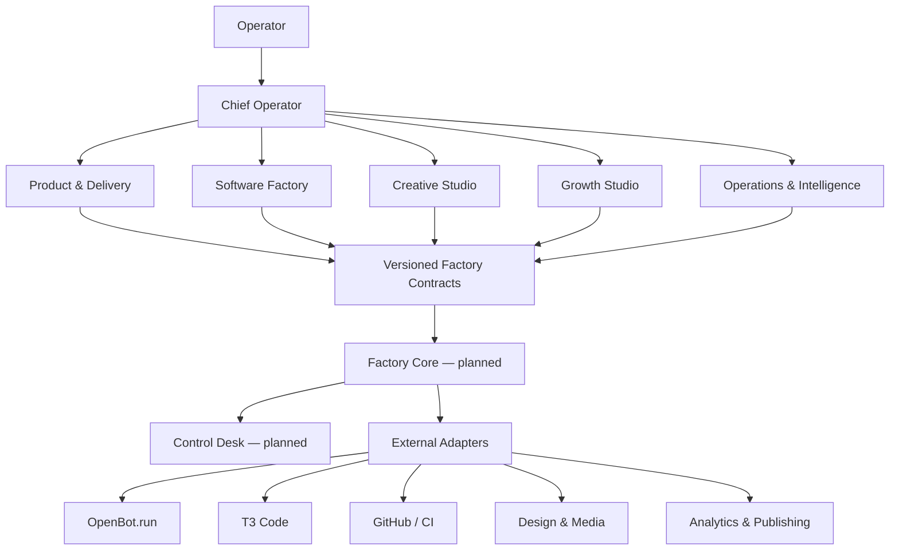

<div align="center">

# Chief Operator Agency & Software Factory

**One human-controlled AI organization for building software, brands, campaigns, and content.**

Use one Chief Operator as your front door. Behind it, professional team leads, bounded subagents, reusable skills, structured memory, and approval gates coordinate work across software engineering, design, marketing, analytics, and operations.

[](TASKS.md)
[](fixtures/acceptance/VALIDATION.md)
[](agents/README.md)
[](skills/README.md)
[](schemas)
[](docs/01-governance/team-constitution.md)

[Overview](#overview) · [Architecture](#architecture) · [Team](#professional-team) · [Capabilities](#capability-coverage) · [Quick Start](#quick-start) · [Roadmap](#roadmap)

</div>

---

## Overview

This repository is the operating foundation for a local-first, human-supervised agency and software factory. It is designed for a solo operator who wants the leverage of a professional multidisciplinary team without managing a separate conversation for every specialist.

The operator normally communicates only with the **Chief Operator**. The Chief Operator identifies the project and intended outcome, routes bounded work to the appropriate team, reconciles evidence and disagreements, and presents one consolidated result or exact approval request.

The factory is designed to support:

- Web applications, websites, dashboards, APIs, desktop applications, and mobile applications.
- Product strategy, architecture, project planning, management, and automation.
- Frontend, backend, database, DevOps, security, performance, QA, and release readiness.
- Brand strategy, UI/UX, design systems, accessibility, and graphic design.
- Text, image, and video ideation, production planning, review, and delivery.
- Marketing strategy, social media, advertising, SEO, AEO, GEO, analytics, and audits.
- Evidence-based retrospectives and controlled process improvement.

> [!IMPORTANT]
> This repository contains the factory’s governance, contracts, roles, skills, plans, and synthetic tests. It does not claim that OpenBot, external providers, publishing accounts, GitHub integrations, or the future Control Desk application are already live.

## Why this architecture?

Multi-agent systems often fail by creating overlapping bots, giving them unclear authority, or treating generated prose as proof that work succeeded. This factory takes a stricter approach:

- **One front door:** the operator works through the Chief Operator.
- **Clear ownership:** every material artifact has one accountable owner.
- **Bounded delegation:** every handoff specifies inputs, output, scope, exclusions, evidence, and stop conditions.
- **Independent review:** consequential work cannot approve itself.
- **One implementer:** overlapping code or creative scope is never assigned to competing agents.
- **Observable completion:** tests, artifacts, receipts, and current system state determine success.
- **Human authority:** sending, publishing, spending, deployment, merge, deletion, credentials, and permission changes require exact approval.
- **Portable operation:** file-based contracts remain usable when an integration is unavailable.

## Architecture



The architecture separates four concerns:

1. **Governance and teams** define authority, ownership, communication, and quality gates.
2. **Factory contracts** define briefs, specifications, tasks, handoffs, results, reviews, approvals, events, memory, and capabilities.
3. **Factory Core** will become the durable source of operational state and workflow transitions.
4. **Control Desk and adapters** will provide the operator interface and controlled access to external systems.

Read the full [system architecture](docs/02-architecture/system-architecture.md) and [data contract model](docs/02-architecture/data-and-contracts.md).

## Professional team

```text
Operator
└── Chief Operator
    ├── Product & Delivery
    │   ├── Product Lead
    │   └── Delivery Manager
    ├── Software Factory
    │   ├── Software Lead
    │   └── Quality, Security & Release Lead
    ├── Creative Studio
    │   └── Design & Content Lead
    ├── Growth Studio
    │   └── Marketing & Growth Lead
    └── Operations & Intelligence
        └── Operations, Analytics & Improvement Lead
```

The factory starts with eight persistent agents because they own recurring artifacts and durable context. Specialized frontend, backend, database, mobile, desktop, DevOps, performance, UX, accessibility, SEO, advertising, image, video, and review work is handled through bounded subagents and reusable skills.

See the [team hierarchy](docs/03-organization/hierarchy.md), [communications protocol](docs/03-organization/communications.md), and [agent definitions](agents/README.md).

## OpenBot.run + T3 Code

The products serve different layers:

| Product | Factory responsibility |
| --- | --- |
| **OpenBot.run** | Persistent agents, team conversations, business workflows, delegated tasks, schedules, provider management, usage visibility, and reusable library items. |
| **T3 Code** | Local coding-agent control plane for Codex, Claude Code, OpenCode, and supported agents; manages coding projects, threads, Git workspaces, and approvals. |
| **GitHub** | Canonical branches, pull requests, code review, CI evidence, and repository protection. |
| **This repository** | Canonical governance, roles, rules, specifications, contracts, skills, memory policy, and result evidence. |

```text
Operator
  → OpenBot Chief Operator
      → approved specification and handoff
          → T3 Code coding thread
              → Codex implementation
              → optional independent Claude review
          → evidence returned to OpenBot Quality Lead
  → exact operator approval before merge or deployment
```

Read the complete [OpenBot and T3 Code operating guide](docs/09-integrations/openbot-and-t3-code.md). The canonical T3 Code product site is [t3.codes](https://t3.codes/).

## Capability coverage

| Capability | Accountable owner | Primary mechanism |
| --- | --- | --- |
| Product strategy and architecture | Product Lead | Briefs, specifications, ADRs |
| Planning and management | Delivery Manager | Milestones, tasks, handoffs, risks |
| Web, dashboard, API, desktop, mobile | Software Lead | Coding agents and stack-specific skills |
| Frontend, backend, database, DevOps | Software Lead | Temporary engineering specialists |
| Security, performance, QA, release | Quality Lead | Independent review and evidence gates |
| Brand, UI/UX, design systems | Design & Content Lead | Design and accessibility workflows |
| Text, image, and video | Design & Content Lead | Production skills and provenance records |
| Marketing, social, advertising | Marketing & Growth Lead | Campaign and content workflows |
| SEO, AEO, GEO, and audits | Marketing & Growth Lead | Source-grounded audit skills |
| Analytics and reporting | Operations Lead | Defined metrics and sourced reports |
| Automation and AI | Product + Software Leads | Approved workflow and integration designs |
| Process improvement | Operations Lead | Evidence, validation, rollback, approval |

The detailed mapping is maintained in the [capability map](docs/05-capabilities/capability-map.md).

## Repository structure

```text
.
├── AGENTS.md              # Durable instructions for coding agents
├── PLAN.md                # Factory roadmap and phase gates
├── TASKS.md               # Outcome-based implementation register
├── docs/                  # Canonical operating documentation
├── plans/                 # Architecture, dashboard, rollout, test plans
├── agents/                # Eight persistent agent definitions
├── subagents/             # Temporary specialist profiles
├── skills/                # Canonical reusable skill packages
├── .agents/skills/        # Discoverable Codex skills where permitted
├── schemas/               # Machine-readable factory contracts
├── templates/             # Human-readable artifact templates
├── rules/                 # Security, coding, memory, action policies
├── memory/                # Scoped, curated organizational memory
├── fixtures/              # Synthetic tests and contract examples
├── openbot/               # Import-ready OpenBot team package
├── prompts/               # Chief Operator and bootstrap prompts
├── scripts/               # Deterministic validation tooling
├── work/                  # Approved project/client working area
└── archive/               # Recoverable pre-rebuild snapshot
```

## Quick start

### 1. Review the operating rules

1. [System Overview](docs/00-overview/system-overview.md)
2. [Team Constitution](docs/01-governance/team-constitution.md)
3. [Authority and Approvals](docs/01-governance/authority-and-approvals.md)
4. [Master Plan](PLAN.md)
5. [Current Tasks](TASKS.md)

### 2. Validate the repository

Requirements: PowerShell 7, Git, Python 3, and `scripts/requirements.txt`.

```powershell
python -m pip install -r scripts/requirements.txt
pwsh -File scripts/validate-factory.ps1
```

With the local Codex skill validator:

```powershell
pwsh -File scripts/validate-factory.ps1 `
  -SkillValidator "$HOME/.codex/skills/.system/skill-creator/scripts/quick_validate.py"
```

Validation covers local Markdown links, skill packages, JSON Schemas, valid and invalid contract fixtures, OpenBot manifest references, agent skill references, and archive hashes. GitHub Actions runs the portable path on pushes and pull requests through [`.github/workflows/validate.yml`](.github/workflows/validate.yml).

### 3. Start through the Chief Operator

Use the [Chief Operator startup prompt](prompts/CHIEF_OPERATOR.md), then create an approved brief from the [project brief template](templates/project-brief.md).

Begin with synthetic work:

- [Software request](fixtures/acceptance/software-request.md)
- [Marketing request](fixtures/acceptance/marketing-request.md)
- [Failure scenarios](fixtures/acceptance/failure-scenarios.md)

### 4. Configure integrations incrementally

Follow the [OpenBot verification checklist](openbot/verification-checklist.md) and [integration policy](docs/09-integrations/integration-policy.md). Start with local, read-only, synthetic tests. Do not connect client data or enable consequential schedules before the manual workflow passes.

## Contracts and evidence

The repository contains 11 JSON Schemas and matching human templates for projects, work items, delegation handoffs, results, reviews, exact approvals, audit events, capabilities, memory, creative provenance, and improvement proposals.

Valid and intentionally invalid examples demonstrate expected behavior under [`fixtures/contracts`](fixtures/contracts).

## Safety model

These actions require explicit approval immediately before execution:

- Sending client or public messages.
- Publishing or scheduling content.
- Starting or changing advertising spend.
- Production deployment or configuration changes.
- Pull-request merge or branch deletion when gated.
- Purchases, credentials, or permission expansion.
- Destructive data or infrastructure operations.
- Factory policy, prompt, routing, or authority changes.

See the [Team Constitution](docs/01-governance/team-constitution.md), [Security and Privacy](docs/08-security/security-and-privacy.md), and [External Action Rules](rules/external-actions.md).

## Current status

### Available now

- Canonical governance and documentation.
- Eight persistent roles and bounded subagent profiles.
- Nineteen validated skill packages.
- Eleven contracts and twelve human templates.
- Import-ready OpenBot team manifest.
- T3 Code operating guidance and rollout plan.
- Synthetic software, marketing, contract, and failure fixtures.
- Local and GitHub Actions validation.

### Planned — not claimed as live

- Imported/configured OpenBot team.
- Verified OpenBot license and provider connections.
- Factory Core application and operational database.
- Control Desk web application.
- Live GitHub, design, media, analytics, publishing, or advertising adapters.
- Production deployment or public automation.

Track exact state in [TASKS.md](TASKS.md) and the [validation record](fixtures/acceptance/VALIDATION.md).

## Roadmap

1. **Foundation:** governance, contracts, agents, skills, fixtures, and validation.
2. **OpenBot team:** verify licensing/version, import agents, and test private handoffs.
3. **Factory Core:** implement durable state, approvals, events, locks, and adapters.
4. **Control Desk:** implement status, queue, evidence, approvals, audit, and recovery UI.
5. **Software integration:** connect a test GitHub repository and prove idempotent spec-to-review delivery.
6. **Creative and growth:** connect approved design, media, analytics, and publishing services.
7. **Improvement:** measure outcomes and apply only approved reversible changes.

See the detailed [roadmap](plans/master/roadmap.md) and [plan index](plans/README.md).

## Contributing and change discipline

- Start from an approved issue, specification, or task.
- Keep changes bounded and evidence-backed.
- Do not edit archived material.
- Update contracts, templates, documentation, and fixtures together when behavior changes.
- Run factory validation before requesting review.
- Do not commit secrets, client data, or generated credentials.

---

<div align="center">

**Local-first · Evidence-driven · Human-controlled**

</div>
