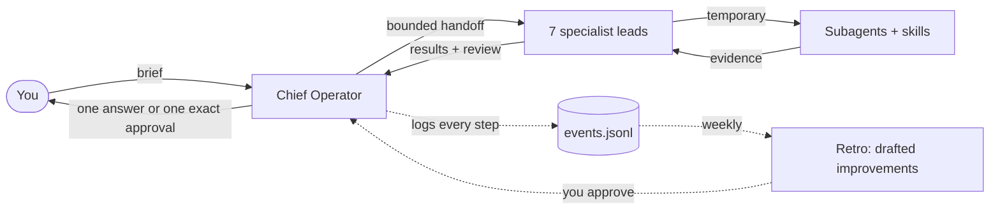

<div align="center">

# Chief Operator Agency & Software Factory

**Run a full AI agency — software, design, marketing and content — through one AI front door, with you holding every key decision.**

You talk to one **Chief Operator**. It plans the work, hands bounded tasks to seven specialist AI leads, checks their evidence, and comes back with one answer or one exact approval request. Nothing gets sent, published, deployed, merged or paid for without your yes.

[](https://github.com/iDorgham/Chief-Operator-Agency-Software-Factory/actions/workflows/validate.yml)
[](agents/README.md)
[](skills/README.md)
[](schemas)
[](docs/01-governance/authority-and-approvals.md)

[Who it's for](#who-its-for) · [How it works](#how-it-works) · [Quick start](#quick-start-5-minutes) · [Daily use](#daily-use) · [Team](#the-team) · [Status](#what-works-today) · [FAQ](#faq)

</div>

---

## Why this exists

Most multi-agent setups break in the same ways: bots overlap, nobody clearly owns anything, agents approve their own work, and a confident paragraph is treated as proof that something shipped.

This repository is the fix, written down as an operating system any AI agent can follow:

- **One front door.** You brief the Chief Operator, not ten bots.
- **One owner per artifact, one implementer per scope.** No two agents edit the same thing.
- **Evidence, not prose.** Tests, CI runs, receipts and files decide when work is done.
- **No self-approval.** A task's owner can never mark it complete. The CLI enforces this.
- **Your approval for anything with consequences.** That covers sending, publishing, ad spend, deployment, merging, deletion, purchases and credentials.
- **It improves itself, with your approval.** Every task is logged, and a weekly retro drafts evidence-backed improvements for you to accept or reject.

## Who it's for

| You are… | You get… |
| --- | --- |
| **A solo founder or freelancer** | A professional multidisciplinary team behind one conversation, with clear approval gates. |
| **A small agency or studio** | Repeatable software, design, content and marketing workflows with separate client contexts and an audit trail. |
| **A developer using Claude Code, Codex or OpenCode** | Drop-in `AGENTS.md`, role prompts, skills and contracts that make coding agents plan, hand off and prove their work. |
| **An AI-ops or automation builder** | Versioned JSON Schemas, a state machine, an event log and a CLI to build your own orchestrator on. |

**Not for you if** you want fully autonomous agents that publish, spend or deploy without a human. This system is deliberately human-gated.

## How it works



**Example:** you ask for a landing page and a launch post.

1. The **Chief Operator** turns your request into a brief with acceptance criteria and asks you only about real unknowns.
2. The **Product Lead** writes the spec, and the **Delivery Manager** splits it into tasks with stable IDs.
3. The **Software Lead** builds the page in a coding agent. The **Design & Content Lead** drafts the post.
4. The **Quality Lead** reviews the evidence: tests, CI and accessibility. The **Marketing Lead** checks the post's claims against sources.
5. You get one summary plus two exact approval cards: *deploy commit `abc123` to production* and *publish this post on LinkedIn at 09:00*.

## Quick start (5 minutes)

**Requirements:** Git, Python 3.10+, and PowerShell 7 for the full validator.

```powershell
git clone https://github.com/iDorgham/Chief-Operator-Agency-Software-Factory.git
cd Chief-Operator-Agency-Software-Factory
python -m pip install -r scripts/requirements.txt
pwsh -File scripts/validate-factory.ps1
```

You should see `Factory validation passed.`

**Try the workflow on the synthetic demo project:**

```powershell
python scripts/factory.py --root fixtures/work status   # board: what's ready, blocked, stale
python scripts/factory.py --root fixtures/work next     # tasks you can start right now
python scripts/factory.py --root fixtures/work retro    # metrics + drafted improvements
```

**Use it with your AI agent:**

- **Claude Code, Codex or OpenCode:** open the repository. These agents read [`AGENTS.md`](AGENTS.md) automatically. Then paste the [Chief Operator prompt](prompts/CHIEF_OPERATOR.md) and give it a brief.
- **Any chat-based model:** paste the [Chief Operator prompt](prompts/CHIEF_OPERATOR.md), then fill in the [project brief template](templates/project-brief.md).
- **OpenBot.run:** import the [team manifest](openbot/team-manifest.yaml) after working through the [verification checklist](openbot/verification-checklist.md).

Start with the synthetic requests in [`fixtures/acceptance/`](fixtures/acceptance) before connecting real accounts or client data.

## Daily use

[`scripts/factory.py`](scripts/factory.py) keeps tasks, events and checks in sync, so no one updates status by hand.

```powershell
# 1. Create a project (add --client <id> for client work)
python scripts/factory.py init-project acme-site --name "Acme website"

# 2. Add tasks: stable IDs, owner, reviewer, acceptance criteria, dependencies
python scripts/factory.py new-task work/projects/acme-site --title "Build pricing page" `
  --owner software-lead --reviewer quality-security-release-lead --criteria "Lighthouse a11y >= 95"

# 3. See what can start, then move work through the state machine
python scripts/factory.py next
python scripts/factory.py move AS-001 approved --actor chief-operator
python scripts/factory.py move AS-001 active   --actor software-lead
python scripts/factory.py move AS-001 review   --actor software-lead --evidence "CI run 123 green"
python scripts/factory.py move AS-001 completed --actor quality-security-release-lead

# 4. Learn from history
python scripts/factory.py retro --write
```

| Speed-up | How it helps |
| --- | --- |
| **[Fast lane](docs/04-workflows/fast-lane.md)** | Small internal reversible tasks go `draft -> active` and can be reviewed by automated checks, so they finish in minutes. |
| **`next`** | Shows only unblocked work, fast-lane tasks first, so nobody starts something that will stall. |
| **Guarded transitions** | Rejects self-approval, review without evidence, and starting before dependencies finish. |
| **Weekly retro** | [`retro.yml`](.github/workflows/retro.yml) measures cycle time, rework and blocked time, then drafts `proposed` improvements. |
| **CI on every push** | [`validate.yml`](.github/workflows/validate.yml) checks schemas, links, skills, work records and tests. |
| **Pre-commit gate** | Run `git config core.hooksPath .githooks` once per clone to catch problems before each commit. |

## The team

```text
You (operator)
└── Chief Operator ─ single front door, routing, final consolidation
    ├── Product Lead                       ─ briefs, specs, architecture decisions
    ├── Delivery Manager                   ─ plans, tasks, handoffs, risks
    ├── Software Lead                      ─ web, API, dashboard, desktop, mobile
    ├── Quality, Security & Release Lead   ─ independent review, tests, release gates
    ├── Design & Content Lead              ─ brand, UI/UX, text, image, video
    ├── Marketing & Growth Lead            ─ social, ads, SEO/AEO/GEO, campaigns
    └── Operations, Analytics & Improvement Lead ─ metrics, reports, retros
```

Eight persistent roles own durable context. Specialists such as frontend, backend, DevOps, accessibility, SEO, video and ads work as temporary [subagents](subagents) using reusable [skills](skills/README.md), so the team stays small but covers the full range. See the [hierarchy](docs/03-organization/hierarchy.md), [communications protocol](docs/03-organization/communications.md) and [capability map](docs/05-capabilities/capability-map.md).

<details>
<summary><b>Capability coverage</b></summary>

| Capability | Owner | Mechanism |
| --- | --- | --- |
| Product strategy and architecture | Product Lead | Briefs, specifications, ADRs |
| Planning and delivery | Delivery Manager | Milestones, tasks, handoffs, risks |
| Web, dashboard, API, desktop, mobile | Software Lead | Coding agents and stack skills |
| Security, performance, QA, release | Quality Lead | Independent review and evidence gates |
| Brand, UI/UX, design systems | Design & Content Lead | Design and accessibility workflows |
| Text, image, video | Design & Content Lead | Production skills with provenance records |
| Social media, ads, SEO/AEO/GEO | Marketing & Growth Lead | [Social media system](docs/04-workflows/social-media-system.md), campaign and audit skills |
| Analytics and improvement | Operations Lead | Sourced reports, retros, approved changes |

</details>

<details>
<summary><b>OpenBot.run + T3 Code + GitHub</b></summary>

| Product | Role in the factory |
| --- | --- |
| **OpenBot.run** | Persistent agents, team conversations, schedules, provider management |
| **T3 Code** | Local control plane for Codex, Claude Code and OpenCode coding threads |
| **GitHub** | Branches, pull requests, review and CI evidence |
| **This repository** | Governance, roles, contracts, skills, memory policy, evidence |

Flow: Chief Operator → approved spec and handoff → T3 Code coding thread → optional independent review → evidence to the Quality Lead → your approval before merge or deploy. See the [integration guide](docs/09-integrations/openbot-and-t3-code.md).

</details>

## What works today

| Available now | Planned (not live yet) |
| --- | --- |
| Governance, roles, authority matrix and quality gates | OpenBot team imported and licence verified |
| 8 agent definitions, subagent profiles, 20 validated skills | Factory Core service and database |
| 11 JSON Schema contracts and 13 templates | Control Desk web app |
| `factory.py` CLI: tasks, state machine, events, retro | Live GitHub, design, media and publishing adapters |
| Synthetic fixtures and CI validation on every push | Production deployment or public automation |

This repository makes no claim that external integrations are live. Exact state lives in [TASKS.md](TASKS.md) and the [validation record](fixtures/acceptance/VALIDATION.md).

## Safety model

These actions always need your explicit approval of the exact action, target and version:

sending messages · publishing or scheduling content · ad spend · production deploys · merges and branch deletion · purchases · credentials and permissions · destructive operations · changes to factory policy or prompts

Read the [Team Constitution](docs/01-governance/team-constitution.md), [Security and Privacy](docs/08-security/security-and-privacy.md) and [External Action Rules](rules/external-actions.md).

## Repository map

```text
AGENTS.md        Instructions every coding agent reads first
PLAN.md          Roadmap and phase gates      TASKS.md    Task register
docs/            Governance, architecture, workflows, operations, security
agents/          8 persistent role definitions
subagents/       Temporary specialist profiles
skills/          Reusable skill packages (+ .agents/skills/)
schemas/         JSON Schema contracts        templates/  Human-readable forms
prompts/         Chief Operator and bootstrap prompts
rules/           Coding, data, memory and external-action policies
scripts/         factory.py CLI, validators, tests
fixtures/        Synthetic projects, contract examples, acceptance cases
work/            Your real project and client work (created by factory.py)
openbot/         Import-ready OpenBot team package
memory/          Scoped, curated memory
archive/         Immutable pre-rebuild snapshot
```

## Roadmap

1. ✅ **Foundation:** governance, contracts, agents, skills, validation, CI.
2. ✅ **Work automation:** `factory.py`, fast lane, weekly retro.
3. ⏳ **OpenBot team:** verify licence and version, import agents, test private handoffs.
4. ⏳ **Factory Core:** durable state, approvals, locks, adapters ([ADR-001](plans/decisions/ADR-001-factory-core-stack.md)).
5. ⏳ **Control Desk:** queue, evidence, approvals, audit and recovery UI.
6. ⏳ **Live integrations:** GitHub test repository, then design, media, analytics and publishing.

Details: [roadmap](plans/master/roadmap.md) · [plan index](plans/README.md) · [changelog](CHANGELOG.md).

## FAQ

**Do I need OpenBot or T3 Code?**
No. Everything works as files plus `factory.py` with any AI agent. OpenBot and T3 Code are optional adapters.

**Which models does it support?**
Any. The rules are model-agnostic, and [model routing](docs/05-capabilities/model-and-tool-routing.md) explains how to pick a model per task.

**Will agents act on my accounts by themselves?**
No. Consequential actions stop at an exact approval request, and the constitution forbids self-approval.

**How does it "self-improve"?**
Each task transition is logged. `retro` finds rework, blocked time and slow cycles, then drafts a specific change with expected benefit, risk, validation and rollback. Nothing is applied until you approve it. See the [improvement loop](docs/04-workflows/improvement-loop.md).

**Can I keep client work separate?**
Yes. Each client gets `work/clients/<client-id>/`, memory is scoped per client, and mixing client contexts is forbidden by policy.

## Contributing

1. Open an issue or start from a task in [TASKS.md](TASKS.md).
2. Keep each change bounded, and update contracts, templates, docs and fixtures together.
3. Run `pwsh -File scripts/validate-factory.ps1` before opening a pull request.
4. Never commit secrets or client data, and never edit `archive/`.

If this helps you run AI agents more safely, **star the repository** so others can find it.

---

<div align="center">

**Local-first · Evidence-driven · Human-controlled**

</div>
