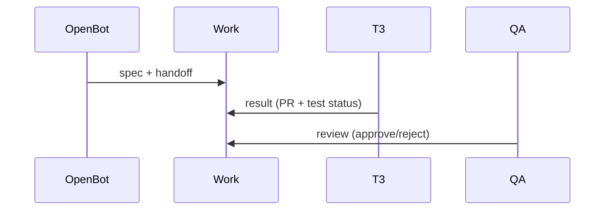

# Handoff Protocol

Files: spec.md, ticket-01.md, handoff.md, result.md, review.md. No spec/no T3; no criteria/no handoff; no review/no merge. Good: repo, branch, scope, criteria, tests, exclusions. Bad: vague request. Rejection cites criterion/evidence; after two rejects stop for operator decision. Mobile approval only after actual diff review.

## Related
- [Factory](factory-pipeline.md)
- [Architecture](architecture.md)
